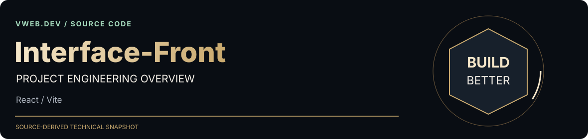

<!-- VWEB:AUTO-README:START -->

### Code-derived project snapshot

| Attribute | Detected value |
|---|---|
| Latest source revision | `3747a87e5966` |
| Tracked files reviewed | 217 |
| Framework and platform indicators | React  /  Vite |
| Source file types | JavaScript (167), JSON (2), CSS (2), HTML (1) |
| Main directories | src, public |

> This section is regenerated from tracked filenames and manifests on code updates. It is not a QA or production-readiness certification. Handwritten project documentation is preserved.
<!-- VWEB:AUTO-README:END -->

# React + Vite

This template provides a minimal setup to get React working in Vite with HMR and some ESLint rules.

Currently, two official plugins are available:

- [@vitejs/plugin-react](https://github.com/vitejs/vite-plugin-react/blob/main/packages/plugin-react) uses [Babel](https://babeljs.io/) for Fast Refresh
- [@vitejs/plugin-react-swc](https://github.com/vitejs/vite-plugin-react/blob/main/packages/plugin-react-swc) uses [SWC](https://swc.rs/) for Fast Refresh

## Expanding the ESLint configuration

If you are developing a production application, we recommend using TypeScript with type-aware lint rules enabled. Check out the [TS template](https://github.com/vitejs/vite/tree/main/packages/create-vite/template-react-ts) for information on how to integrate TypeScript and [`typescript-eslint`](https://typescript-eslint.io) in your project.
